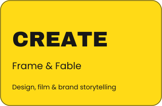
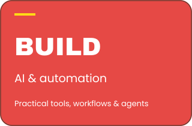
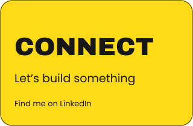

I’m **Anurith Reddy (Sallagonda)**. I bring Adobe creative production together with **AI Workflow Automation** and **Agentic AI Development**.

I work on brand stories at **Frame & Fable** and build practical applications, creative tools, and everyday workflows.

[Frame & Fable](https://frameandfable.in/) · [LinkedIn](https://www.linkedin.com/in/anurith-sallagonda/) · [Instagram](https://www.instagram.com/anurith_sallagonda/) · [YouTube](https://www.youtube.com/@anurithsallagonda7568)

 

### What I work with

- **Creative production:** Adobe tools, video editing, motion graphics, photography, and visual identity.
- **Building:** AI applications, workflow automation, agents, and web experiences.
- **Approach:** Start with a useful problem, make the work clear, and improve it through real use.

Project source repositories are private. Public demos and case studies will be linked here when ready to share.
